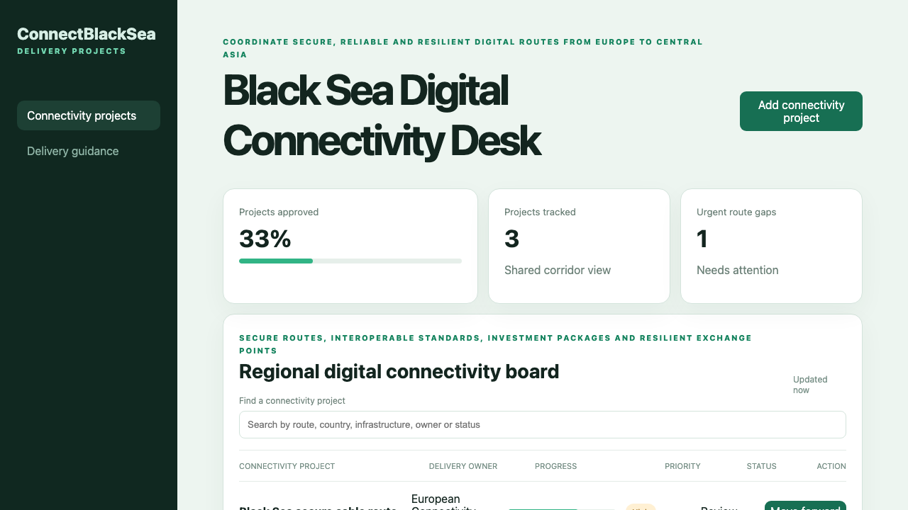

# Black Sea Digital Connectivity Desk

## One-sentence benefit

Coordinate secure connectivity projects linking the European Union, Moldova and the wider Black Sea region.

## Live demo

[Watch the workflow](docs/demo.webm).

## Screenshots

## Main features

- Search and sort connectivity projects across routes and delivery teams.
- Create a corridor project through the Java service.
- Advance draft and review projects toward approval.
- View delivery guidance on a separate route.
- Handle loading, empty, error and success states responsively.

## Technology used

Vue 3, TypeScript, Pinia, Vue Router, Vite, Spring Boot and Java 21.

## Installation instructions

Install Node.js 22 and Java 21. Run `npm install`, then start the backend with `cd backend && mvn spring-boot:run`. In another terminal run `npm run dev`.

## Commercial licensing/contact

Commercial licensing and integration support are available. Use the repository contact options to discuss deployment.

## Business problem and users

Connectivity ministries, infrastructure operators, investors and regional partners need to coordinate secure routes, exchange points, finance and delivery dependencies.

## Key workflows

Find a corridor project, add a connectivity need, review its owner and priority, advance the delivery state and consult the guidance.

## Vue framework highlights

Pinia provides reactive API state and computed metrics, Vue Router separates operational and guidance views, and Vue templates expose accessible live updates.

## Java backend highlights

Spring Boot supplies validated list, search, create and update APIs, consistent error responses, a health endpoint and tested service rules.

## Architecture and state flow

Vue actions call `/api/items` through the development proxy. The Java controller validates requests, the service owns workflow state and responses update the Pinia store.

## Accessibility and responsive behaviour

The interface uses labelled search, semantic navigation, keyboard controls, readable status text and layouts that collapse cleanly on small screens.

## Verification commands

Run `npm test`, `npm run build`, `cd backend && mvn test` and `cd backend && mvn package`.

## Structure

`src` holds the Vue routes and store, `backend` holds the Java API, and `docs` holds inspected media.

## Tradeoffs

The sample uses in-memory records for a fast local setup. A production service should add identity, persistence and partner data exchange.

## Roadmap

Add cable-route maps, resilience assessments, financing milestones, permit dependencies and cross-border alerts.
